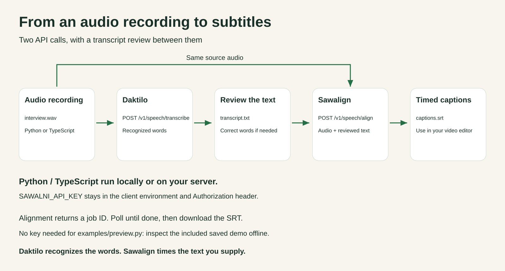

# Audio recording → transcript → subtitles

Python and TypeScript examples for [Sawalni API](https://api.sawalni.com). Daktilo recognizes the words in an audio recording. Sawalign places a transcript against that audio and exports timed subtitles.

## Python

Use Python 3.11+ and your own audio recording:

```sh
python3 -m venv .venv
. .venv/bin/activate
pip install -r python/requirements.txt
export SAWALNI_API_KEY="your-key"
python python/src/main.py transcribe interview.wav --transcript-output transcript.txt
```

Open `transcript.txt` and review the words. Then align the reviewed text:

```sh
python python/src/main.py align interview.wav --text transcript.txt --output captions.srt
```

Use the same audio recording for both steps. Alignment times the text you supply; it does not correct recognition errors.

## TypeScript

Use Node 24+:

```sh
cd typescript
npm ci
export SAWALNI_API_KEY="your-key"
npm start -- transcribe ../interview.wav --transcript-output transcript.txt
# Review transcript.txt, then:
npm start -- align ../interview.wav transcript.txt captions.srt
```

Both entry points accept your file paths. `SAWALNI_API_KEY` comes from the environment; the scripts do not load `.env` automatically. Create a key and enable model access at [api.sawalni.com](https://api.sawalni.com). Live requests use API credits.

## How it works



The transcribe command sends audio to `POST /v1/speech/transcribe` with `model=daktilo`. The align command sends audio and text to `POST /v1/speech/align`, polls the returned job, and downloads SRT when it is done. Credentials stay in your terminal or server process.

## Try the same example as the walkthrough

No key needed to inspect the saved result:

```sh
python3 examples/preview.py
```

`examples/demo/` contains a real Darija audio excerpt, transcript, reviewed text and SRT. Play `audio.wav`, inspect the text and open `captions.srt`. [Audio source and license](examples/demo/README.md).

To run it live, pass `examples/demo/audio.wav` to the same commands above. Saved text/timings are excerpts from the longer recorded run; a new request can return different results.

## Other commands

For a quick draft without a review step:

```sh
python python/src/main.py subtitles interview.wav --output draft.srt
```

For translated text or captions, add `--source ary_Arab --target eng_Latn` to the existing translation commands. See [translation examples](docs/translation.md). Translation is optional; the core workflow above keeps the source language.

## Files and checks

- `python/src/main.py`, `typescript/src/main.ts`: CLI workflows to adapt.
- `python/src/client.py`, `typescript/src/client.ts`: HTTP transport.
- `examples/demo/`: saved demonstration.

Requests are not automatically retried. Alignment polling stops after ten minutes and reports the job ID. HTTP errors, failed jobs, empty or truncated transcripts stop the workflow. Audio inputs are limited to 128 MiB; transcript inputs to 1 MiB.

```sh
python tests/smoke.py
cd typescript
npm test
npm run check
```

The smoke test uses a local HTTP fixture and makes no paid requests. [API reference](https://api.sawalni.com/docs) · [MIT code license](LICENSE).
